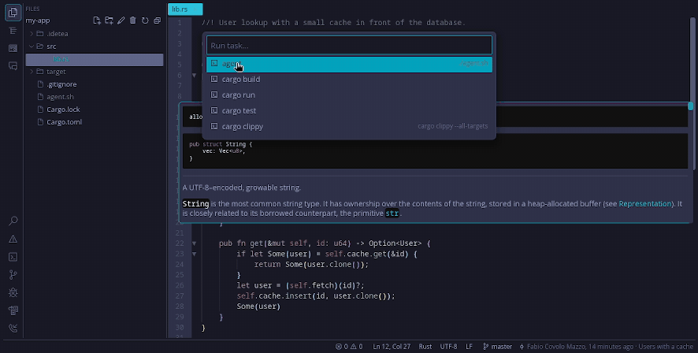

<p align="center">
  
</p>

<h1 align="center">IDE TEA</h1>

<p align="center"><b>Just code. Add ice.</b></p>

<p align="center">
  Un IDE rápido y silencioso, en Rust puro con <a href="https://github.com/iced-rs/iced">iced</a>,<br>
  hecho para trabajar codo a codo con agentes de código. Gratis, siempre: <a href="LICENSE">Apache 2.0</a>.
</p>

<p align="center">
  <a href="README.md">English</a> · <a href="README.pt-BR.md">Português</a> · <b>Español</b>
</p>

<p align="center"></p>

---

IDE TEA abre en un parpadeo, no estorba y te dice lo que está haciendo. Sin cuenta, sin telemetría, sin
marketplace, sin ventanas emergentes pidiendo tu atención. Solo usa la red cuando tú lo pides (push, pull, fetch).

También es un IDE pensado para la forma en que muchos programamos hoy: **con un agente en la terminal de al lado**.
En vez de una caja de chat pegada a un costado, IDE TEA les da a los agentes un protocolo pequeño, hecho de
archivos, para hablar contigo a través del propio IDE, y te deja al mando de todo lo que ejecutan.

> **Estado:** en desarrollo activo, antes de la 1.0. Hecho y probado en Linux (Wayland). macOS y Windows aún no se
> han probado. Habrá asperezas; por favor, avísanos cuando encuentres una.

## Por qué IDE TEA

**Rápido.** Abre muy por debajo de 200 ms. Un archivo de 50 MB abre en una décima de segundo, y un archivo
minificado con una línea gigante abre en un modo ligero en vez de congelar la ventana.

**Silencioso.** Una ventana, ningún aviso que no hayas causado, ninguna actualización sorpresa. Apariencia, atajos y
paneles viven en un archivo TOML simple (global o por proyecto), con una pantalla de configuración para lo mismo.

**Completo donde importa.** Editor con multicursor y modo vim opcional, árbol de archivos, búsqueda en el proyecto,
terminal integrada con pestañas, git (stage, diff, commit, push y pull), LSP para los lenguajes habituales, depuración
con gdb, y vistas previas de Markdown, SVG, imágenes y PDF.

**Pequeño por dentro.** El núcleo solo sabe editar archivos. Todo lo demás (árbol, terminal, git, depuración…) es
una extensión que puedes desactivar.

**Hecho para agentes, contigo al mando.**

- **Preguntas en un panel de verdad, no en el chat.** El agente escribe un pequeño archivo JSON y el IDE lo muestra
  como formulario: opciones, casillas, campos de texto, imágenes, sonidos, pruebas manuales paso a paso con botones
  de "aprobado" y "falló". Tu respuesta vuelve en un archivo que el agente lee.
- **Terminales que el agente pide y tú apruebas.** Un agente puede pedirle al IDE una terminal que ejecute un
  comando: un servidor de desarrollo, otro agente, una herramienta interactiva. Ves el comando completo antes de que
  nada se ejecute. Una lista corta en *tu* configuración (nunca en la del proyecto) puede saltarse la pregunta para
  los comandos en los que confías.
- **Agentes que delegan en agentes.** Un agente ayudante puede trabajar en su propio worktree de git, en su propia
  rama, para que dos agentes nunca toquen los mismos archivos. La respuesta del ayudante vuelve en un archivo; el
  código vuelve por la rama y por tu revisión de siempre.
- **Proyectos nuevos que empiezan con las skills adecuadas.** "Proyecto: nuevo…" crea la carpeta, git, las skills de
  agente de la tecnología (Rust, Python, FastAPI, sitio web…) y un pedido inicial, y abre el agente en una terminal
  del IDE para que lo apruebes.
- **Un comando para enseñar a cualquier agente.** "Interfaces: enseñar a los agentes de este proyecto" escribe el
  protocolo en `AGENTS.md` y `CLAUDE.md`. Funciona con Claude Code, Codex y cualquier agente que lea esos archivos.

## Instalación

**Linux, listo para usar:** descarga el `.tar.gz` o el AppImage de tu máquina (x86_64 o aarch64) en
[Releases](https://github.com/fabiocmazzo/idetea/releases). En el `.tar.gz`, `./install.sh` pone `idetea` en
`~/.local/bin` y en el menú de aplicaciones. El AppImage funciona tal cual (antes, `chmod +x`); `--install-desktop`
lo pone en el menú. `SHA256SUMS` tiene las sumas de verificación.

**Desde el código fuente:** necesitas [Rust](https://rustup.rs) (estable). Después:

```sh
cargo install --locked --git https://github.com/fabiocmazzo/idetea tea-app
idetea --install-desktop   # opcional: entrada en el menú de aplicaciones e ícono
```

Opcionales: `git` para la integración con git, `gdb` 14+ para depurar, y los servidores de lenguaje que uses
(rust-analyzer, clangd, pyright, typescript-language-server, gopls y lua-language-server ya vienen configurados).

## Primeros pasos

```sh
idetea                # abre la carpeta actual como proyecto
idetea src/main.rs    # carpeta actual + este archivo
idetea ~/proyecto     # otra carpeta
idetea new mi-app --model rust --agent claude   # un proyecto nuevo, con un agente listo para empezar
```

Dentro del IDE: `Ctrl+Shift+P` abre la paleta de comandos, `Ctrl+P` abre un archivo por nombre, `F1` muestra todos
los atajos.

## Sobre el nombre

Empezó como una broma. El IDE está hecho con **iced**, así que tenía que llamarse **Iced Tea**.

Luego apareció el otro sentido. En portugués, **TEA** es la sigla de *Transtorno do Espectro Autista* (en español,
trastorno del espectro autista, que también es TEA). El autor es autista, el doble sentido pareció justo y el nombre
se quedó. Quizá eso explique algunas cosas del IDE: le gusta lo predecible, el texto simple que se puede leer y el
menor ruido posible.

Más en el [manifiesto](MANIFESTO.es.md).

## Documentación

- [Manifiesto](MANIFESTO.es.md): en qué cree IDE TEA, y lo que no va a hacer.
- [Funciones y atajos](docs/features.md): la lista completa, para quien quiere el detalle técnico (en inglés).
- [Interfaces para agentes](docs/interfaces/formato.md) y [terminales de agente](docs/terminais-de-agente.md) (en
  portugués por ahora).
- [SPEC.md](SPEC.md) y [DESENVOLVIMENTO.md](DESENVOLVIMENTO.md): especificación, arquitectura y cómo compilar,
  probar y escribir una extensión (en portugués por ahora).

## Licencia

IDE TEA es software libre bajo la [Licencia Apache 2.0](LICENSE): úsalo, estúdialo, modifícalo y compártelo,
también comercialmente. Es gratis y lo seguirá siendo.

Los íconos de la interfaz son de la fuente [Codicons](https://github.com/microsoft/vscode-codicons) © Microsoft,
bajo [CC BY 4.0](https://creativecommons.org/licenses/by/4.0/) (ver
[`crates/tea-core/assets/NOTICE.md`](crates/tea-core/assets/NOTICE.md)).
