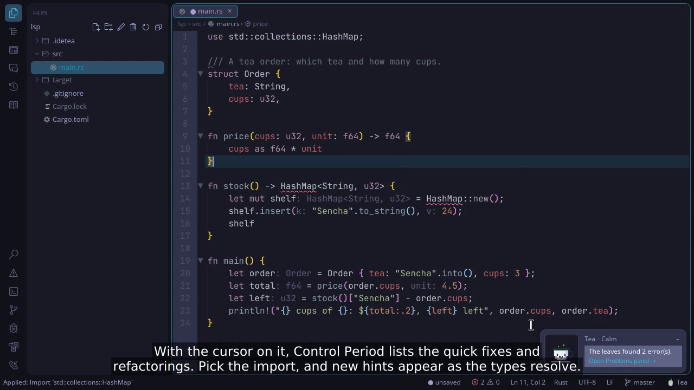

<p align="center">
  
</p>

<h1 align="center">IDE TEA</h1>

<p align="center"><b>Juste le code. La glace, tu la mets.</b></p>

<p align="center">
  Un IDE rapide et silencieux, en Rust pur, où les agents de code demandent avant d'agir.<br>
  Gratuit, toujours : <a href="LICENSE">Apache 2.0</a>. Sans compte, sans télémétrie, sans marketplace.
</p>

<p align="center">
  <a href="https://github.com/fabiocmazzo/idetea/actions/workflows/ci.yml"></a>
  <a href="https://github.com/fabiocmazzo/idetea/releases"></a>
  <a href="LICENSE"></a>
  <a href="https://www.rust-lang.org/"></a>
  <a href="https://github.com/iced-rs/iced"></a>
  
  <a href="https://codeberg.org/fabiocmazzo/idetea"></a>
</p>

<p align="center">
  <a href="README.md">English</a> · <a href="README.pt-BR.md">Português</a> · <a href="README.es.md">Español</a> ·
  <b>Français</b> · <a href="README.de.md">Deutsch</a> · <a href="README.it.md">Italiano</a> ·
  <a href="README.ja.md">日本語</a> · <a href="README.zh-CN.md">中文（简体）</a><br>
  <a href="https://idetea.belabs.cloud/fr/"><b>Site et guides</b></a>
  · <a href="https://github.com/fabiocmazzo/idetea">GitHub</a>
  · <a href="https://codeberg.org/fabiocmazzo/idetea">Codeberg</a> (miroir)
</p>

<p align="center">
  <a href="https://idetea.belabs.cloud/fr/#demo">
    
  </a>
</p>

<p align="center">
  <a href="https://idetea.belabs.cloud/fr/#demo"><b>Voir la démo de 52 secondes</b></a>
  · narration en anglais, sous-titres incrustés<br>
  GitHub ne lit pas un fichier vidéo du dépôt dans le README.
  L'extrait ci-dessus l'ouvre sur le site, où il se joue avec le son.
  Le fichier lui-même est <a href="assets/idetea-demo.mp4"><code>assets/idetea-demo.mp4</code></a>.
</p>

---

> **État :** en développement actif, avant la 1.0. Compilé et testé sous Linux, macOS (Apple Silicon) et Windows (x86_64).
> Il reste des aspérités ; merci de les signaler.

## À qui il s'adresse

Aux personnes qui écrivent du code avec un agent dans le terminal, à côté de l'éditeur : Claude Code, Codex, ou tout agent qui lit
`AGENTS.md` et `CLAUDE.md`. IDE TEA ne place pas de modèle de conversation dans la fenêtre. Il donne à cet agent un moyen
petit, fait de fichiers, de vous poser des questions, et vous laisse décider de chaque commande.

## Pourquoi les gens restent

**Rapide.** Démarre largement sous les 200 ms. Un fichier de 50 Mo s'ouvre en un dixième de seconde, et un fichier minifié
d'une seule ligne géante s'ouvre dans un mode léger, au lieu de figer la fenêtre.

**Silencieux.** Sans compte, sans télémétrie, sans marketplace, sans fenêtre que vous n'avez pas demandée. Le réseau ne sert
que lorsque vous le demandez (pousser, tirer, récupérer, ou une compétence que vous installez). L'apparence, les raccourcis
et les panneaux vivent dans un seul fichier TOML.

**Vous approuvez ce qui s'exécute.** Un agent écrit un petit fichier JSON et l'IDE affiche un formulaire : options, cases,
texte, images, sons, tests manuels étape par étape. Une demande de terminal montre d'abord la commande entière. Un assistant
peut travailler dans son propre worktree git. Un projet ne peut jamais s'accorder une permission. Votre liste d'autorisation
vit dans *votre* configuration.

**Complet là où ça compte.** Curseurs multiples, zoom temporaire, mode vim facultatif, arborescence, recherche dans le
projet, terminal intégré, git (indexer, diff, valider, pousser et tirer), LSP, débogage avec gdb, et aperçus pour Markdown,
SVG, images et PDF.

**Petit à l'intérieur.** Le noyau ne fait qu'éditer des fichiers. L'arborescence, le terminal, git et le débogueur sont des
extensions que vous pouvez désactiver. Tea, une tasse en pixel art, guette une question en attente (un clic ouvre le bon
panneau) et se replie dans la barre d'état quand vous voulez récupérer le coin.

Une commande enseigne aux agents du projet : « Interfaces : enseigner aux agents de ce projet » écrit le protocole dans
`AGENTS.md` et `CLAUDE.md`.

## Les fonctions en action

Cinq courts extraits, narration en anglais, sous-titres incrustés. GitHub ne lit pas un fichier vidéo du dépôt
dans le README. Les affiches ouvrent l'extrait sur le site, avec le son. Les fichiers sont dans `assets/`.

<table>
<tr>
  <td width="50%" valign="top">
    <a href="https://idetea.belabs.cloud/fr/#feature-agents"></a><br>
    <a href="https://idetea.belabs.cloud/fr/#feature-agents"><b>Agents</b></a> · 57 secondes<br>
    Des agents dans votre terminal. La mémoire dans votre dépôt.<br>
    <a href="assets/idetea-agents.mp4"><code>assets/idetea-agents.mp4</code></a>
  </td>
  <td width="50%" valign="top">
    <a href="https://idetea.belabs.cloud/fr/#feature-tables"></a><br>
    <a href="https://idetea.belabs.cloud/fr/#feature-tables"><b>Tableaux</b></a> · 45 secondes<br>
    Vos données en tableau. Ce n'est toujours que du texte.<br>
    <a href="assets/idetea-tables.mp4"><code>assets/idetea-tables.mp4</code></a>
  </td>
</tr>
<tr>
  <td width="50%" valign="top">
    <a href="https://idetea.belabs.cloud/fr/#feature-lsp"></a><br>
    <a href="https://idetea.belabs.cloud/fr/#feature-lsp"><b>LSP</b></a> · 41 secondes<br>
    Un support linguistique profond, intégré.<br>
    <a href="assets/idetea-lsp.mp4"><code>assets/idetea-lsp.mp4</code></a>
  </td>
  <td width="50%" valign="top">
    <a href="https://idetea.belabs.cloud/fr/#feature-encodings"></a><br>
    <a href="https://idetea.belabs.cloud/fr/#feature-encodings"><b>Encodages</b></a> · 47 secondes<br>
    Anciens fichiers, nouvel éditeur, rien n'est perdu.<br>
    <a href="assets/idetea-encodings.mp4"><code>assets/idetea-encodings.mp4</code></a>
  </td>
</tr>
<tr>
  <td width="50%" valign="top">
    <a href="https://idetea.belabs.cloud/fr/#feature-mascot"></a><br>
    <a href="https://idetea.belabs.cloud/fr/#feature-mascot"><b>Mascotte</b></a> · 52 secondes<br>
    Une tasse de thé calme, dans votre langue.<br>
    <a href="assets/idetea-mascot.mp4"><code>assets/idetea-mascot.mp4</code></a>
  </td>
  <td width="50%" valign="top"></td>
</tr>
</table>

## Installation

**Linux, macOS et Windows, prêts à l'emploi.** La version actuelle est
[v0.18.0](https://github.com/fabiocmazzo/idetea/releases/tag/v0.18.0).
`SHA256SUMS` sur cette page contient les sommes de contrôle. Changez `VERSION` quand une plus récente sort, ou
prenez le fichier depuis les [Releases](https://github.com/fabiocmazzo/idetea/releases).

**Linux (x86_64).** Décompressez et lancez `install.sh`. Il place `idetea` dans `~/.local/bin` et l'ajoute au menu des applications :

```sh
VERSION=0.18.0
curl -fsSL -O "https://github.com/fabiocmazzo/idetea/releases/download/v${VERSION}/idetea-${VERSION}-x86_64-linux.tar.gz"
tar -xzf idetea-${VERSION}-x86_64-linux.tar.gz
cd idetea-${VERSION}-x86_64-linux
./install.sh
```

Pour ARM, utilisez `idetea-${VERSION}-aarch64-linux.tar.gz`. Si vous préférez un seul fichier, téléchargez
`IDE_TEA-${VERSION}-x86_64.AppImage` (ou `IDE_TEA-${VERSION}-aarch64.AppImage`), puis `chmod +x` et lancez-le.
`--install-desktop` l'ajoute au menu.

**macOS (Apple Silicon).** L'archive contient `IDE TEA.app` :

```sh
VERSION=0.18.0
curl -fsSL -O "https://github.com/fabiocmazzo/idetea/releases/download/v${VERSION}/idetea-${VERSION}-aarch64-macos.tar.gz"
tar -xzf idetea-${VERSION}-aarch64-macos.tar.gz
cd idetea-${VERSION}-aarch64-macos
./idetea --install-desktop   # crée ~/Applications/IDE TEA.app
```

Il n'y a pas encore de paquet pour Mac Intel.

**Windows (x86_64).** Téléchargez et lancez
[IDE_TEA-0.18.0-x86_64-setup.exe](https://github.com/fabiocmazzo/idetea/releases/download/v0.18.0/IDE_TEA-0.18.0-x86_64-setup.exe),
ou décompressez le
[idetea-0.18.0-x86_64-windows.zip](https://github.com/fabiocmazzo/idetea/releases/download/v0.18.0/idetea-0.18.0-x86_64-windows.zip)
portable (`idetea.exe` est à l'intérieur). Dans PowerShell :

```powershell
$Version = "0.18.0"
Invoke-WebRequest -Uri "https://github.com/fabiocmazzo/idetea/releases/download/v$Version/IDE_TEA-$Version-x86_64-setup.exe" -OutFile "IDE_TEA-$Version-x86_64-setup.exe"
Start-Process ".\IDE_TEA-$Version-x86_64-setup.exe"
```

**Depuis les sources.** Il vous faut [Rust](https://rustup.rs) (stable). Le paquet s'appelle `tea-app` ; le binaire s'appelle `idetea` :

```sh
cargo install --locked --git https://github.com/fabiocmazzo/idetea tea-app
idetea --install-desktop   # facultatif : entrée de menu et icône
```

Facultatif : `git` pour l'intégration git, `gdb` 14+ (ou `lldb-dap` sous macOS) pour le débogage, et les serveurs de
langage que vous utilisez (rust-analyzer, clangd, pyright, typescript-language-server, gopls, lua-language-server, zls,
`zx lsp`, `hare-lsp` pour Hare et `moon lsp` pour MoonBit sont déjà configurés).

## Signature du code et confidentialité

L'installateur Windows n'est pas encore signé, SmartScreen peut donc afficher un avertissement au premier lancement.
Ce programme ne transmet aucune information à d'autres systèmes en réseau sauf demande explicite de l'utilisateur.
Voir [`CODE_SIGNING_POLICY.md`](CODE_SIGNING_POLICY.md).

## Démarrage rapide

```sh
idetea                # ouvre le dossier courant comme projet
idetea src/main.rs    # dossier courant + ce fichier
idetea ~/projet       # un autre dossier
idetea new my-app --model rust --agent claude     # un nouveau projet, avec un agent prêt à le commencer
```

Dans l'IDE : `Ctrl+Shift+P` ouvre la palette de commandes, `Ctrl+P` ouvre un fichier par son nom, `F1` montre tous les
raccourcis. Les guides sont sur le [site](https://idetea.belabs.cloud/fr/).

## Pourquoi IDE TEA, et quand s'en passer

[`docs/comparativo-ides.fr.md`](docs/comparativo-ides.fr.md) est une comparaison honnête avec VS Code, Cursor, Zed,
JetBrains et Helix, mise à jour pour la 0.15.0. En bref :

- Les agents du terminal ont un protocole natif, fait de fichiers (formulaires, commandes approuvées, worktrees, la
  mascotte Tea). C'est ce que les autres éditeurs de cette note n'ont pas.
- Il n'y a pas d'autocomplétion en texte fantôme, volontairement. Si vous voulez compléter avec Tab ou des diffs dans
  le texte, ce document indique Cursor, Windsurf ou Zed.
- La couverture du débogueur est en retrait par rapport à VS Code et JetBrains (gdb et lldb-dap seulement).

### Tea

La tasse dans le coin a plusieurs répliques pour chaque humeur. Elle remarque un enregistrement, une longue pause,
l'heure de la journée et la compilation du débogueur, et elle peut citer de temps en temps un vrai raccourci.
`[mascot] chatty` vaut `quiet`, `normal` ou `chatty` ; `[mascot] tips` active ou coupe les astuces. Toute l'interface,
Tea compris, est en portugais, anglais, espagnol, français, allemand, italien, japonais et chinois simplifié
(`[ui] language`, ou la langue du système). Elle parle aussi une fois d'un conflit sur disque avec des
modifications non enregistrées, d'un conflit git, de la fin d'une tâche ou d'une session de débogage, d'un
caractère que l'encodage ne peut pas garder et d'un remplacement dans plusieurs fichiers. Les avertissements et
les erreurs qui disparaissent restent en mode chatty. Les mêmes interrupteurs sont dans les Paramètres.
`idetea mascot setup-hooks` ajoute les hooks de Claude Code et laisse ceux qui sont déjà dans le fichier. Elle
ne prend pas le focus.

## Mettre une étoile au dépôt

Si c'est l'éditeur que vous cherchiez, [mettez une étoile à IDE TEA](https://github.com/fabiocmazzo/idetea). C'est le
projet d'une personne, et une étoile est la façon dont la personne suivante le trouve.

## À propos du nom

Ça a commencé par une blague. L'IDE est fait avec **iced**, alors il fallait que ce soit **Iced Tea**.

Puis l'autre sens est apparu. En portugais, **TEA** est le sigle de *Transtorno do Espectro Autista* : le trouble du
spectre de l'autisme. L'auteur est autiste, et le double sens lui a semblé juste, alors le nom est resté. Cela explique
peut-être quelques traits de l'IDE : il aime la prévisibilité, le texte simple que l'on peut lire, et le moins de bruit
possible.

La suite est dans le [manifeste](MANIFESTO.fr.md).

## Documentation

- [Manifeste](MANIFESTO.fr.md) : ce en quoi IDE TEA croit, et ce qu'il ne fera pas.
- [Site](https://idetea.belabs.cloud/fr/) : la démo, l'installation et les guides.
- [Contributing](CONTRIBUTING.md) : comment compiler, tester et ouvrir une pull request (en anglais).
- [Fonctionnalités et raccourcis](docs/features.fr.md) : la liste complète.
- [Langages](docs/languages.fr.md) : ce que l'IDE fait pour chaque langage, y compris Hare et MoonBit, avec des
  [exemples](examples/languages) à essayer.
- [Interfaces pour les agents](docs/interfaces/formato.md) et [terminaux d'agent](docs/terminais-de-agente.md) (en
  portugais pour l'instant).
- [SPEC.md](SPEC.md) et [DESENVOLVIMENTO.md](DESENVOLVIMENTO.md) : spécification, architecture, et comment compiler,
  tester et écrire une extension (en portugais pour l'instant).

## Licence

IDE TEA est un logiciel libre sous la [licence Apache 2.0](LICENSE) : utilisez-le, étudiez-le, modifiez-le et
partagez-le, y compris commercialement. Il est gratuit, et il le restera.

Les icônes de l'interface viennent de [Codicons](https://github.com/microsoft/vscode-codicons) © Microsoft, sous
[CC BY 4.0](https://creativecommons.org/licenses/by/4.0/) (voir
[`crates/tea-core/assets/NOTICE.md`](crates/tea-core/assets/NOTICE.md)).
