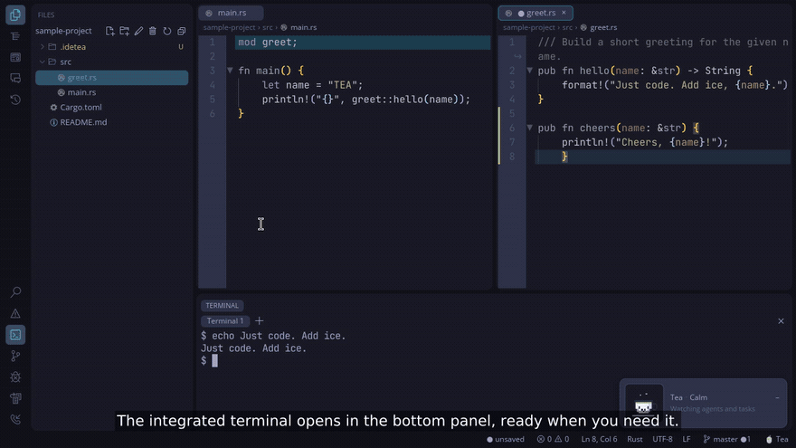

<p align="center">
  
</p>

<h1 align="center">IDE TEA</h1>

<p align="center"><b>Solo il codice. Il ghiaccio lo metti tu.</b></p>

<p align="center">
  Un IDE veloce e silenzioso, in Rust puro, dove gli agenti di codice chiedono prima di agire.<br>
  Gratis, sempre: <a href="LICENSE">Apache 2.0</a>. Niente account, niente telemetria, niente marketplace.
</p>

<p align="center">
  <a href="README.md">English</a> · <a href="README.pt-BR.md">Português</a> · <a href="README.es.md">Español</a> ·
  <a href="README.fr.md">Français</a> · <a href="README.de.md">Deutsch</a> · <b>Italiano</b> ·
  <a href="README.ja.md">日本語</a> · <a href="README.zh-CN.md">中文（简体）</a><br>
  <a href="https://idetea.belabs.cloud/it/"><b>Sito e guide</b></a>
  · <a href="https://github.com/fabiocmazzo/idetea">GitHub</a>
</p>

<p align="center">
  <a href="https://idetea.belabs.cloud/it/#demo">
    
  </a>
</p>

<p align="center">
  <a href="https://idetea.belabs.cloud/it/#demo"><b>Guarda la demo di 52 secondi</b></a>
  · narrazione in inglese, sottotitoli impressi<br>
  GitHub non riproduce un video del repository dentro il README.
  Il clip sopra lo apre sul sito, dove parte con l'audio.
  Il file è <a href="assets/idetea-demo.mp4"><code>assets/idetea-demo.mp4</code></a>.
</p>

---

> **Stato:** in sviluppo attivo, prima della 1.0. Compilato e provato su Linux, macOS (Apple Silicon) e Windows (x86_64).
> Ci saranno spigoli: se ne trovi uno, segnalalo.

## A chi serve

A chi scrive codice con un agente nel terminale, accanto all'editor: Claude Code, Codex, o qualsiasi agente che legga
`AGENTS.md` e `CLAUDE.md`. IDE TEA non mette un modello di chat dentro la finestra. Dà a quell'agente un modo piccolo,
fatto di file, per farti delle domande, e resti tu a decidere ogni comando.

## Perché resti

**Veloce.** Parte ben al di sotto dei 200 ms. Un file da 50 MB si apre in un decimo di secondo, e un file minificato
con una riga enorme si apre in una modalità leggera, invece di bloccare la finestra.

**Silenzioso.** Niente account, niente telemetria, niente marketplace, niente finestre su funzioni che non hai chiesto.
La rete si usa solo quando lo chiedi tu (push, pull, recupera, o una skill che installi). Aspetto, tasti e pannelli
stanno in un unico file TOML, in chiaro.

**Decidi tu che cosa viene eseguito.** Un agente scrive un piccolo file JSON e l'IDE mostra un modulo: opzioni,
caselle, testo, immagini, suoni, test manuali passo per passo. Una richiesta di terminale mostra prima il comando
intero. Un aiutante può girare nel proprio worktree di git (albero di lavoro). Un progetto non può mai darsi il
permesso da solo. L'elenco consentiti sta nella *tua* config.

**Completo dove conta.** Più cursori, zoom temporaneo, una modalità vim facoltativa, albero dei file, ricerca nel
progetto, terminale integrato, git (aggiungi a stage, diff, commit, push e pull), LSP, debug con gdb, e anteprime di
Markdown, SVG, immagini e PDF.

**Piccolo dentro.** Il nucleo modifica solo file. L'albero, il terminale, git e il debugger sono estensioni che puoi
spegnere. Tea, una tazza in pixel art, tiene d'occhio una domanda in attesa (un clic apre il pannello giusto) e si
comprime nella barra di stato quando rivuoi l'angolo.

Un comando insegna agli agenti del progetto: «Interfacce: insegna agli agenti di questo progetto» scrive il
protocollo in `AGENTS.md` e `CLAUDE.md`.

## Installazione

**Linux, macOS e Windows, pronto all'uso.** Scarica il pacchetto per la tua piattaforma dalle
[Release](https://github.com/fabiocmazzo/idetea/releases): `.tar.gz` o `.AppImage` per Linux x86_64/aarch64,
`.tar.gz` con `IDE TEA.app` per macOS aarch64, oppure l'installer `-setup.exe` / lo `.zip` portatile per Windows x86_64.
`SHA256SUMS` ha le somme di controllo.

Su Linux, `./install.sh` mette `idetea` in `~/.local/bin` e lo aggiunge al menu delle applicazioni. L'AppImage parte
così com'è (`chmod +x` prima) e `--install-desktop` lo aggiunge al menu. Su macOS, `--install-desktop` crea
`~/Applications/IDE TEA.app`.

**Dal codice sorgente.** Serve [Rust](https://rustup.rs) (stable). Poi:

```sh
cargo install --locked --git https://github.com/fabiocmazzo/idetea tea-app
idetea --install-desktop   # facoltativo: voce nel menu e icona
```

Facoltativi: `git` per l'integrazione git, `gdb` 14+ (o `lldb-dap` su macOS) per il debug, e i server di linguaggio
che usi (rust-analyzer, clangd, pyright, typescript-language-server, gopls, lua-language-server, zls, `zx lsp`, `hare-lsp` per Hare e `moon lsp` per MoonBit sono già configurati).

## Firma del codice e privacy

La firma gratuita su Windows è fornita da [SignPath.io](https://signpath.io), certificato della
[SignPath Foundation](https://signpath.org). Questo programma non trasferisce informazioni ad altri sistemi in rete,
se non su richiesta esplicita di chi lo usa. Vedi [`CODE_SIGNING_POLICY.md`](CODE_SIGNING_POLICY.md).

## Per iniziare

```sh
idetea                # apre la cartella attuale come progetto
idetea src/main.rs    # cartella attuale + questo file
idetea ~/progetto     # un'altra cartella
idetea new my-app --model rust --agent claude     # un progetto nuovo, con un agente pronto a iniziarlo
```

Dentro l'IDE: `Ctrl+Shift+P` apre il riquadro comandi, `Ctrl+P` apre un file per nome, `F1` mostra ogni scelta rapida.
Le guide sono sul [sito](https://idetea.belabs.cloud/it/).

## Perché IDE TEA, e quando no

[`docs/comparativo-ides.it.md`](docs/comparativo-ides.it.md) è un confronto onesto con VS Code, Cursor, Zed, JetBrains
e Helix, scritto intorno alla 0.4.0. La parte che è ancora il prodotto:

- Gli agenti nel terminale hanno un protocollo nativo, fatto di file (moduli, comandi approvati, worktree, la
  mascotte Tea). È la cosa che gli altri editor di quella nota non hanno.

### Tea

La tazza nell'angolo ha diverse frasi per ogni umore. Nota un salvataggio, una pausa lunga, l'ora del giorno e la
compilazione del debugger, e ogni tanto cita una scelta rapida che esiste davvero. `[mascot] chatty` vale `quiet`,
`normal` o `chatty`; `[mascot] tips` accende o spegne i suggerimenti. Tutta l'interfaccia, Tea compreso, è in
portoghese, inglese, spagnolo, francese, tedesco, italiano, giapponese e cinese semplificato (`[ui] language`, oppure
la lingua del sistema). Non prende il focus.
- Niente autocompletamento fantasma, di proposito. Se vuoi completare con Tab o i diff in linea, quel documento
  indica Cursor, Windsurf o Zed.
- Code action, inlay hint e copertura del debugger sono indietro rispetto a VS Code e JetBrains.

La stessa nota dice ancora «solo Linux». Le versioni successive escono anche per macOS (Apple Silicon) e Windows (x86_64).

## Metti una stella al repository

Se questo è l'editor che volevi, [metti una stella a IDE TEA](https://github.com/fabiocmazzo/idetea). È il progetto
di una persona, e la stella è il modo in cui lo trova la persona successiva.

## Sul nome

È nato da una battuta. L'IDE è fatto con **iced**, quindi doveva chiamarsi **Iced Tea**.

Poi è saltato fuori l'altro senso. In portoghese, **TEA** è la sigla di *Transtorno do Espectro Autista*: il
disturbo dello spettro autistico. L'autore è autistico, il doppio senso gli è sembrato giusto, e il nome è rimasto.
Forse spiega anche qualcosa dell'IDE: preferisce la prevedibilità, il testo semplice che si può leggere, e
meno rumore possibile.

Il resto è nel [manifesto](MANIFESTO.it.md).

## Documentazione

- [Manifesto](MANIFESTO.it.md): in che cosa crede IDE TEA, e che cosa non farà.
- [Sito](https://idetea.belabs.cloud/it/): la demo, l'installazione e le guide.
- [Funzionalità e scelte rapide](docs/features.it.md): l'elenco completo.
- [Linguaggi](docs/languages.it.md): che cosa fa l'IDE per ogni linguaggio, Hare e MoonBit compresi, con
  [esempi](examples/languages) da provare.
- [Interfacce per gli agenti](docs/interfaces/formato.md) e [terminali di agente](docs/terminais-de-agente.md) (per
  ora in portoghese).
- [SPEC.md](SPEC.md) e [DESENVOLVIMENTO.md](DESENVOLVIMENTO.md): specifica, architettura e come compilare,
  provare e scrivere un'estensione (per ora in portoghese).

## Licenza

IDE TEA è software libero sotto la [Licenza Apache 2.0](LICENSE): usalo, studialo, modificalo e condividilo,
anche a scopo commerciale. È gratuito e lo resta.

Le icone dell'interfaccia vengono da [Codicons](https://github.com/microsoft/vscode-codicons) © Microsoft, sotto
[CC BY 4.0](https://creativecommons.org/licenses/by/4.0/) (vedi
[`crates/tea-core/assets/NOTICE.md`](crates/tea-core/assets/NOTICE.md)).
