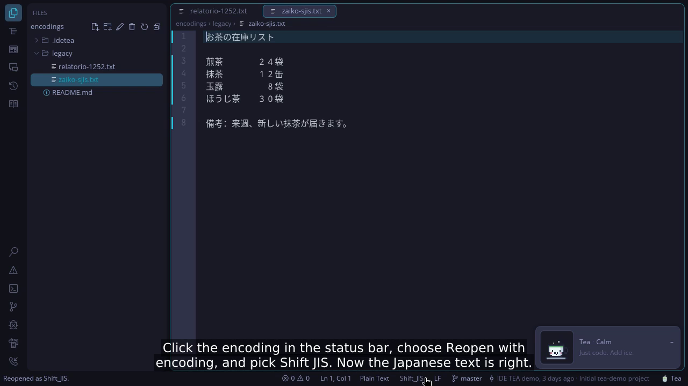

<p align="center">
  
</p>

<h1 align="center">IDE TEA</h1>

<p align="center"><b>コードだけでいい。氷はあとで。</b></p>

<p align="center">
  純粋な Rust で作った、高速で静かな IDE です。コーディング エージェントは、動く前に尋ねます。<br>
  ずっと無料: <a href="LICENSE">Apache 2.0</a>。アカウントなし、テレメトリなし、マーケットプレースなし。
</p>

<p align="center">
  <a href="https://github.com/fabiocmazzo/idetea/actions/workflows/ci.yml"></a>
  <a href="https://github.com/fabiocmazzo/idetea/releases"></a>
  <a href="LICENSE"></a>
  <a href="https://www.rust-lang.org/"></a>
  <a href="https://github.com/iced-rs/iced"></a>
  
  <a href="https://codeberg.org/fabiocmazzo/idetea"></a>
</p>

<p align="center">
  <a href="README.md">English</a> · <a href="README.pt-BR.md">Português</a> · <a href="README.es.md">Español</a> ·
  <a href="README.fr.md">Français</a> · <a href="README.de.md">Deutsch</a> · <a href="README.it.md">Italiano</a> ·
  <b>日本語</b> · <a href="README.zh-CN.md">中文（简体）</a><br>
  <a href="https://idetea.belabs.cloud/ja/"><b>Web サイトとガイド</b></a>
  · <a href="https://github.com/fabiocmazzo/idetea">GitHub</a>
  · <a href="https://codeberg.org/fabiocmazzo/idetea">Codeberg</a> (ミラー)
</p>

<p align="center">
  <a href="https://idetea.belabs.cloud/ja/#demo">
    
  </a>
</p>

<p align="center">
  <a href="https://idetea.belabs.cloud/ja/#demo"><b>52 秒のデモを見る</b></a>
  · 英語のナレーション。字幕は映像に入っています<br>
  GitHub は、リポジトリ内の動画ファイルを README の中では再生しません。
  上の画像は Web サイトでデモを開き、音声付きで再生します。
  ファイルは <a href="assets/idetea-demo.mp4"><code>assets/idetea-demo.mp4</code></a> です。
</p>

---

> **状態:** 1.0 より前の、開発中です。Linux、macOS (Apple Silicon)、Windows (x86_64) でビルドとテストをしています。
> 粗い部分があります。見つけたら報告してください。

## 対象

エディターのそばのターミナルで、エージェントとコードを書く人向けです。Claude Code、Codex、または
`AGENTS.md` と `CLAUDE.md` を読むエージェントです。IDE TEA は、ウィンドウの中にチャット モデルを置きません。
エージェントには、ファイルを使った小さな質問の手段を渡し、すべてのコマンドは承認制です。

## 使い続ける理由

**高速。** 起動は 200 ms を大きく下回ります。50 MB のファイルは 0.1 秒で開きます。1 行が巨大なミニファイ済みファイルは、ウィンドウを固める代わりに、軽量モードで開きます。

**静か。** アカウントも、テレメトリも、マーケットプレースも、頼んでいないポップアップもありません。ネットワークを使うのは、要求したときだけです (プッシュ、プル、フェッチ、またはインストールするスキル)。外観、キー、パネルは、1 つのプレーンな TOML ファイルにあります。

**実行の承認。** エージェントが小さな JSON を書くと、IDE はフォームを表示します。選択肢、チェックボックス、テキスト、画像、音声、手順のある手動テストです。ターミナルの要求は、先にコマンド全文を表示します。ヘルパーは、専用の git worktree で実行できます。プロジェクトが自分に許可を与えることはできません。許可リストは、利用者の設定にあります。

**必要なところは一通り。** マルチ カーソル、一時的なズーム、任意の vim モード、ファイル ツリー、プロジェクト検索、統合ターミナル、git (ステージ、差分、コミット、プッシュ、プル)、LSP、gdb によるデバッグ、Markdown、SVG、画像、PDF のプレビューです。

**中身は小さい。** コアが編集するのはファイルだけです。ツリー、ターミナル、git、デバッグは、オフにできる拡張機能です。ピクセル アートのティーカップ Tea は、待っている質問を見張り (1 クリックで該当パネルを開きます)、隅を戻したいときはステータス バーへ折りたたみます。

1 つのコマンドが、プロジェクトのエージェントに教えます。「インターフェース: このプロジェクトのエージェントに教える」は、手順を
`AGENTS.md` と `CLAUDE.md` に書きます。

## 機能の実演

短いクリップが 5 本あります。ナレーションは英語で、字幕は映像に入っています。GitHub は、リポジトリ内の動画ファイルを README の中では再生しません。ポスターを開くと Web サイトで音声付きで再生します。ファイルは `assets/` にあります。

<table>
<tr>
  <td width="50%" valign="top">
    <a href="https://idetea.belabs.cloud/ja/#feature-agents"></a><br>
    <a href="https://idetea.belabs.cloud/ja/#feature-agents"><b>エージェント</b></a> · 57 秒<br>
    ターミナルのエージェント。記憶はリポジトリに。<br>
    <a href="assets/idetea-agents.mp4"><code>assets/idetea-agents.mp4</code></a>
  </td>
  <td width="50%" valign="top">
    <a href="https://idetea.belabs.cloud/ja/#feature-tables"></a><br>
    <a href="https://idetea.belabs.cloud/ja/#feature-tables"><b>テーブル</b></a> · 45 秒<br>
    データは表に。中身はただのテキスト。<br>
    <a href="assets/idetea-tables.mp4"><code>assets/idetea-tables.mp4</code></a>
  </td>
</tr>
<tr>
  <td width="50%" valign="top">
    <a href="https://idetea.belabs.cloud/ja/#feature-lsp"></a><br>
    <a href="https://idetea.belabs.cloud/ja/#feature-lsp"><b>LSP</b></a> · 41 秒<br>
    深い言語サポートを、最初から。<br>
    <a href="assets/idetea-lsp.mp4"><code>assets/idetea-lsp.mp4</code></a>
  </td>
  <td width="50%" valign="top">
    <a href="https://idetea.belabs.cloud/ja/#feature-encodings"></a><br>
    <a href="https://idetea.belabs.cloud/ja/#feature-encodings"><b>文字コード</b></a> · 47 秒<br>
    古いファイルも、新しいエディターで、そのまま。<br>
    <a href="assets/idetea-encodings.mp4"><code>assets/idetea-encodings.mp4</code></a>
  </td>
</tr>
<tr>
  <td width="50%" valign="top">
    <a href="https://idetea.belabs.cloud/ja/#feature-mascot"></a><br>
    <a href="https://idetea.belabs.cloud/ja/#feature-mascot"><b>マスコット</b></a> · 52 秒<br>
    落ち着いた一杯のティーを、あなたの言語で。<br>
    <a href="assets/idetea-mascot.mp4"><code>assets/idetea-mascot.mp4</code></a>
  </td>
  <td width="50%" valign="top"></td>
</tr>
</table>

## インストール

**Linux、macOS、Windows。すぐに実行できます。** 現在のリリースは
[v0.15.0](https://github.com/fabiocmazzo/idetea/releases/tag/v0.15.0) です。
そのページの `SHA256SUMS` にチェックサムがあります。新しい版が出たら `VERSION` を変えるか、
[Releases](https://github.com/fabiocmazzo/idetea/releases) からファイルを選んでください。

**Linux (x86_64).** 展開して `install.sh` を実行します。`idetea` を `~/.local/bin` に置き、アプリ メニューに追加します:

```sh
VERSION=0.15.0
curl -fsSL -O "https://github.com/fabiocmazzo/idetea/releases/download/v${VERSION}/idetea-${VERSION}-x86_64-linux.tar.gz"
tar -xzf idetea-${VERSION}-x86_64-linux.tar.gz
cd idetea-${VERSION}-x86_64-linux
./install.sh
```

ARM では `idetea-${VERSION}-aarch64-linux.tar.gz` を使います。単一ファイルがよい場合は
`IDE_TEA-${VERSION}-x86_64.AppImage`（または `IDE_TEA-${VERSION}-aarch64.AppImage`）をダウンロードし、`chmod +x` して実行します。
`--install-desktop` でメニューに追加します。

**macOS (Apple Silicon).** アーカイブに `IDE TEA.app` が入っています:

```sh
VERSION=0.15.0
curl -fsSL -O "https://github.com/fabiocmazzo/idetea/releases/download/v${VERSION}/idetea-${VERSION}-aarch64-macos.tar.gz"
tar -xzf idetea-${VERSION}-aarch64-macos.tar.gz
cd idetea-${VERSION}-aarch64-macos
./idetea --install-desktop   # ~/Applications/IDE TEA.app を作ります
```

Intel Mac 向けのビルドはまだありません。

**Windows (x86_64).**
[IDE_TEA-0.15.0-x86_64-setup.exe](https://github.com/fabiocmazzo/idetea/releases/download/v0.15.0/IDE_TEA-0.15.0-x86_64-setup.exe)
をダウンロードして実行するか、ポータブルな
[idetea-0.15.0-x86_64-windows.zip](https://github.com/fabiocmazzo/idetea/releases/download/v0.15.0/idetea-0.15.0-x86_64-windows.zip)
を展開します（中に `idetea.exe` があります）。PowerShell では:

```powershell
$Version = "0.15.0"
Invoke-WebRequest -Uri "https://github.com/fabiocmazzo/idetea/releases/download/v$Version/IDE_TEA-$Version-x86_64-setup.exe" -OutFile "IDE_TEA-$Version-x86_64-setup.exe"
Start-Process ".\IDE_TEA-$Version-x86_64-setup.exe"
```

**ソースから。** [Rust](https://rustup.rs) (stable) が必要です。パッケージ名は `tea-app`、バイナリ名は `idetea` です:

```sh
cargo install --locked --git https://github.com/fabiocmazzo/idetea tea-app
idetea --install-desktop   # 任意: アプリ メニューの項目とアイコン
```

任意: git 統合用の `git`、デバッグ用の `gdb` 14 以降 (macOS では `lldb-dap`)、使う言語サーバーです (rust-analyzer、clangd、pyright、typescript-language-server、gopls、lua-language-server、zls、`zx lsp`、Hare 用の `hare-lsp`、MoonBit 用の `moon lsp` は設定済みです)。

## コード署名とプライバシー

Windows インストーラーにはまだコード署名がないため、初回実行時に SmartScreen が警告を出すことがあります。このプログラムは、利用者が明示的に要求しない限り、情報を他のネットワーク上のシステムへ転送しません。
[`CODE_SIGNING_POLICY.md`](CODE_SIGNING_POLICY.md) を参照してください。

## クイック スタート

```sh
idetea                # 現在のフォルダーをプロジェクトとして開く
idetea src/main.rs    # 現在のフォルダーと、このファイル
idetea ~/project      # 別のフォルダー
idetea new my-app --model rust --agent claude     # 新しいプロジェクト。開始できるエージェント付き
```

IDE の中では、`Ctrl+Shift+P` がコマンド パレット、`Ctrl+P` が名前でファイルを開く、`F1` がすべてのショートカットです。
ガイドは [Web サイト](https://idetea.belabs.cloud/ja/) にあります。

## IDE TEA を選ぶとき、選ばないとき

[`docs/comparativo-ides.ja.md`](docs/comparativo-ides.ja.md) は、VS Code、Cursor、Zed、JetBrains、
Helix との率直な比較で、0.8.0 に合わせて更新しています。要点:

- ターミナルのエージェントは、ファイルベースのネイティブな手順を得ます (フォーム、承認したコマンド、worktree、マスコット Tea)。あの文書の他のエディターには、これがありません。
- ゴースト テキストの補完は、意図してありません。Tab 補完やインライン差分が必要なら、あの文書は Cursor、Windsurf、Zed を示します。
- コード アクション、インレイ ヒント、デバッグの対応範囲は、VS Code と JetBrains より後ろです。

### Tea

隅のティーカップには、気分ごとにいくつかの台詞があります。保存、長い休止、時刻、デバッグのビルドに気づき、
実在するショートカットを時々示します。`[mascot] chatty` は `quiet`、`normal`、`chatty` です。
`[mascot] tips` はヒントのオンとオフです。インターフェース全体 (Tea を含む) は、ポルトガル語、英語、
スペイン語、フランス語、ドイツ語、イタリア語、日本語、簡体字中国語です (`[ui] language`、またはシステムの言語)。
フォーカスは取りません。

## リポジトリにスターを付ける

探していたエディターなら、[IDE TEA にスターを付けてください](https://github.com/fabiocmazzo/idetea)。1 人のプロジェクトで、
スターが次の人の見つけ方です。

## 名前について

冗談から始まりました。IDE は **iced** で作られているので、**Iced Tea** になるほかありませんでした。

それから、もう一つの意味が現れました。ポルトガル語では、**TEA** は *Transtorno do Espectro Autista*（自閉スペクトラム症）です。
作者は自閉スペクトラム症で、この二重の意味がしっくりきたので、名前は残りました。IDE のいくつかの性質も、これで説明がつくかもしれません。
予測できること、読めるプレーンなテキスト、できるだけ少ない雑音を好みます。

詳しくは [マニフェスト](MANIFESTO.ja.md) です。

## ドキュメント

- [マニフェスト](MANIFESTO.ja.md): IDE TEA が信じることと、しないこと。
- [Web サイト](https://idetea.belabs.cloud/ja/): デモ、インストール、ガイド。
- [Contributing](CONTRIBUTING.md): ビルド、テスト、プル リクエストの出し方（英語）。
- [機能とショートカット](docs/features.ja.md): 一覧。
- [言語](docs/languages.ja.md): 各言語で IDE がすること。Hare と MoonBit を含み、
  試す [例](examples/languages) があります。
- [エージェント向けインターフェース](docs/interfaces/formato.md) と [エージェント ターミナル](docs/terminais-de-agente.md)
  （現時点ではポルトガル語）。
- [SPEC.md](SPEC.md) と [DESENVOLVIMENTO.md](DESENVOLVIMENTO.md): 仕様、アーキテクチャ、ビルド、テスト、
  拡張機能の書き方（現時点ではポルトガル語）。

## ライセンス

IDE TEA は [Apache License 2.0](LICENSE) のフリー ソフトウェアです。使用、研究、変更、共有ができます。
商用も同様です。無償であり、これからも無償です。

インターフェースのアイコンは [Codicons](https://github.com/microsoft/vscode-codicons) © Microsoft で、
[CC BY 4.0](https://creativecommons.org/licenses/by/4.0/) です
([`crates/tea-core/assets/NOTICE.md`](crates/tea-core/assets/NOTICE.md) を参照)。
