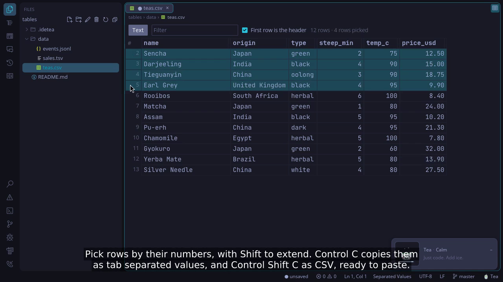
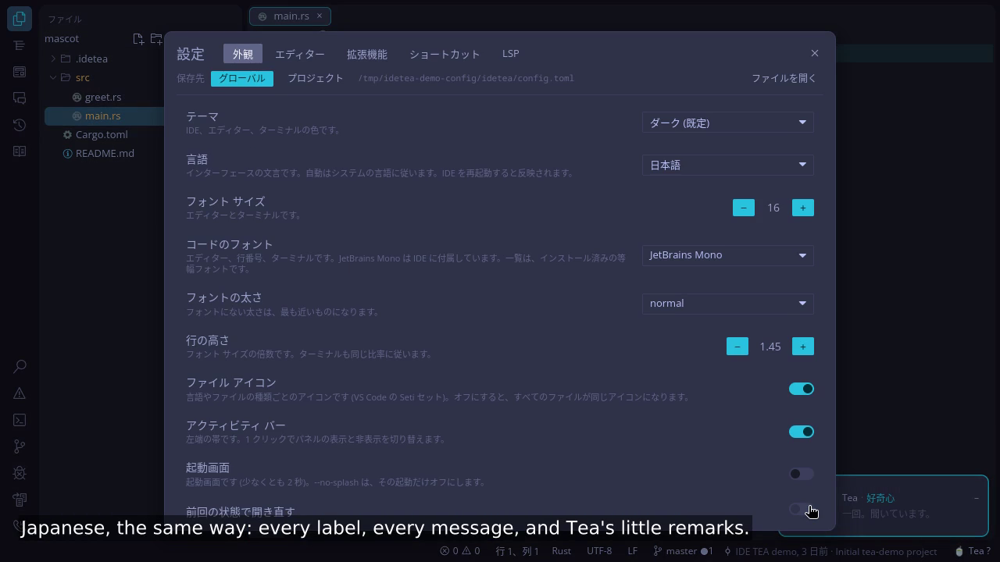

<p align="center">
  
</p>

<h1 align="center">IDE TEA</h1>

<p align="center"><b>Just code. Add ice.</b></p>

<p align="center">
  Uma IDE rápida e silenciosa, em Rust puro, em que os agentes de código perguntam antes de agir.<br>
  Gratuita, sempre: <a href="LICENSE">Apache 2.0</a>. Sem conta, sem telemetria, sem marketplace.
</p>

<p align="center">
  <a href="https://github.com/fabiocmazzo/idetea/actions/workflows/ci.yml"></a>
  <a href="https://github.com/fabiocmazzo/idetea/releases"></a>
  <a href="LICENSE"></a>
  <a href="https://www.rust-lang.org/"></a>
  <a href="https://github.com/iced-rs/iced"></a>
  
  <a href="https://codeberg.org/fabiocmazzo/idetea"></a>
</p>

<p align="center">
  <a href="README.md">English</a> · <b>Português</b> · <a href="README.es.md">Español</a> ·
  <a href="README.fr.md">Français</a> · <a href="README.de.md">Deutsch</a> · <a href="README.it.md">Italiano</a> ·
  <a href="README.ja.md">日本語</a> · <a href="README.zh-CN.md">中文（简体）</a><br>
  <a href="https://idetea.belabs.cloud/pt-br/"><b>Site e guias</b></a>
  · <a href="https://github.com/fabiocmazzo/idetea">GitHub</a>
  · <a href="https://codeberg.org/fabiocmazzo/idetea">Codeberg</a> (espelho)
</p>

<p align="center">
  <a href="https://idetea.belabs.cloud/pt-br/#demo">
    
  </a>
</p>

<p align="center">
  <a href="https://idetea.belabs.cloud/pt-br/#demo"><b>Assistir à demo de 52 segundos</b></a>
  · narração em inglês, legendas na imagem<br>
  O GitHub não toca um vídeo do repositório dentro do README.
  O clipe acima abre a demo no site, com som.
  O arquivo está em <a href="assets/idetea-demo.mp4"><code>assets/idetea-demo.mp4</code></a>.
</p>

---

> **Status:** em desenvolvimento ativo, antes da 1.0. Compilada e testada em Linux, macOS (Apple Silicon) e Windows (x86_64).
> Espere arestas, e por favor avise quando achar uma.

## Para quem é

Para quem programa com um agente no terminal ao lado do editor: Claude Code, Codex, ou qualquer agente que leia o
`AGENTS.md` e o `CLAUDE.md`. A IDE TEA não coloca um modelo de chat dentro da janela. Ela dá a esse agente um jeito
pequeno, feito de arquivos, de perguntar, e deixa você no comando de cada comando.

## Por que a gente fica

**Rápida.** Abre bem abaixo de 200 ms. Um arquivo de 50 MB abre em um décimo de segundo, e um arquivo minificado
com uma linha gigante abre num modo leve em vez de travar a janela.

**Silenciosa.** Sem conta, sem telemetria, sem marketplace, sem pop-up que você não pediu. A rede só entra quando
você pede (push, pull, fetch, ou uma skill que você instala). Aparência, atalhos e painéis ficam num arquivo TOML.

**Você aprova o que roda.** O agente escreve um JSON pequeno e a IDE mostra um formulário: opções, caixas, texto,
imagens, sons, teste manual passo a passo. O pedido de terminal mostra o comando inteiro antes. Um ajudante pode
rodar no próprio worktree do git. Um projeto nunca se dá permissão sozinho. A lista de permissão fica no *seu* config.

**Completa onde importa.** Vários cursores, zoom temporário, modo vim opcional, árvore de arquivos, busca no
projeto, terminal integrado, git (stage, diff, commit, push e pull), LSP, depuração com gdb, e prévias de
Markdown, SVG, imagem e PDF.

**Pequena por dentro.** O núcleo só edita arquivo. Árvore, terminal, git e depurador são extensões que você pode
desligar. O Tea, uma xícara em pixel art, avisa quando tem pergunta esperando (um clique abre o painel certo) e
se recolhe na barra de status quando você quer o canto de volta.

Um comando ensina os agentes do projeto: "Interfaces: ensinar os agentes deste projeto" grava o protocolo no
`AGENTS.md` e no `CLAUDE.md`.

## Funcionalidades em ação

Cinco clipes curtos, narração em inglês, legendas na imagem. O GitHub não toca um vídeo do repositório dentro
do README. Os pôsteres abrem o clipe no site, com som. Os arquivos estão em `assets/`.

<table>
<tr>
  <td width="50%" valign="top">
    <a href="https://idetea.belabs.cloud/pt-br/#feature-agents"></a><br>
    <a href="https://idetea.belabs.cloud/pt-br/#feature-agents"><b>Agentes</b></a> · 57 segundos<br>
    Agentes no seu terminal. Memória no seu repositório.<br>
    <a href="assets/idetea-agents.mp4"><code>assets/idetea-agents.mp4</code></a>
  </td>
  <td width="50%" valign="top">
    <a href="https://idetea.belabs.cloud/pt-br/#feature-tables"></a><br>
    <a href="https://idetea.belabs.cloud/pt-br/#feature-tables"><b>Tabelas</b></a> · 45 segundos<br>
    Seus dados como tabela. Continua sendo só texto.<br>
    <a href="assets/idetea-tables.mp4"><code>assets/idetea-tables.mp4</code></a>
  </td>
</tr>
<tr>
  <td width="50%" valign="top">
    <a href="https://idetea.belabs.cloud/pt-br/#feature-lsp"></a><br>
    <a href="https://idetea.belabs.cloud/pt-br/#feature-lsp"><b>LSP</b></a> · 41 segundos<br>
    Suporte profundo à linguagem, já embutido.<br>
    <a href="assets/idetea-lsp.mp4"><code>assets/idetea-lsp.mp4</code></a>
  </td>
  <td width="50%" valign="top">
    <a href="https://idetea.belabs.cloud/pt-br/#feature-encodings"></a><br>
    <a href="https://idetea.belabs.cloud/pt-br/#feature-encodings"><b>Codificações</b></a> · 47 segundos<br>
    Arquivos antigos, editor novo, nada se perde.<br>
    <a href="assets/idetea-encodings.mp4"><code>assets/idetea-encodings.mp4</code></a>
  </td>
</tr>
<tr>
  <td width="50%" valign="top">
    <a href="https://idetea.belabs.cloud/pt-br/#feature-mascot"></a><br>
    <a href="https://idetea.belabs.cloud/pt-br/#feature-mascot"><b>Mascote</b></a> · 52 segundos<br>
    Uma xícara de chá calma, no seu idioma.<br>
    <a href="assets/idetea-mascot.mp4"><code>assets/idetea-mascot.mp4</code></a>
  </td>
  <td width="50%" valign="top"></td>
</tr>
</table>

## Instalando

**Linux, macOS e Windows, pronta para rodar.** A versão atual é a
[v0.22.0](https://github.com/fabiocmazzo/idetea/releases/tag/v0.22.0).
O `SHA256SUMS` nessa página tem as somas de verificação. Troque o `VERSION` quando sair uma mais nova, ou pegue o
arquivo em [Releases](https://github.com/fabiocmazzo/idetea/releases).

**Linux (x86_64).** Descompacte e rode o `install.sh`. Ele põe o `idetea` em `~/.local/bin` e no menu de aplicativos:

```sh
VERSION=0.22.0
curl -fsSL -O "https://github.com/fabiocmazzo/idetea/releases/download/v${VERSION}/idetea-${VERSION}-x86_64-linux.tar.gz"
tar -xzf idetea-${VERSION}-x86_64-linux.tar.gz
cd idetea-${VERSION}-x86_64-linux
./install.sh
```

No ARM, use `idetea-${VERSION}-aarch64-linux.tar.gz`. Se preferir um arquivo só, baixe
`IDE_TEA-${VERSION}-x86_64.AppImage` (ou `IDE_TEA-${VERSION}-aarch64.AppImage`), dê `chmod +x` e execute.
`--install-desktop` põe no menu.

**macOS (Apple Silicon).** O arquivo traz o `IDE TEA.app`:

```sh
VERSION=0.22.0
curl -fsSL -O "https://github.com/fabiocmazzo/idetea/releases/download/v${VERSION}/idetea-${VERSION}-aarch64-macos.tar.gz"
tar -xzf idetea-${VERSION}-aarch64-macos.tar.gz
cd idetea-${VERSION}-aarch64-macos
./idetea --install-desktop   # cria ~/Applications/IDE TEA.app
```

Ainda não há pacote para Mac com Intel.

**Windows (x86_64).** Baixe e execute o
[IDE_TEA-0.22.0-x86_64-setup.exe](https://github.com/fabiocmazzo/idetea/releases/download/v0.22.0/IDE_TEA-0.22.0-x86_64-setup.exe),
ou descompacte o
[idetea-0.22.0-x86_64-windows.zip](https://github.com/fabiocmazzo/idetea/releases/download/v0.22.0/idetea-0.22.0-x86_64-windows.zip)
portátil (o `idetea.exe` está dentro). No PowerShell:

```powershell
$Version = "0.22.0"
Invoke-WebRequest -Uri "https://github.com/fabiocmazzo/idetea/releases/download/v$Version/IDE_TEA-$Version-x86_64-setup.exe" -OutFile "IDE_TEA-$Version-x86_64-setup.exe"
Start-Process ".\IDE_TEA-$Version-x86_64-setup.exe"
```

**Pelo código-fonte.** Você precisa do [Rust](https://rustup.rs) (estável). O pacote é `tea-app`; o binário se chama `idetea`:

```sh
cargo install --locked --git https://github.com/fabiocmazzo/idetea tea-app
idetea --install-desktop   # opcional: entrada no menu de aplicativos e ícone
```

Opcionais: `git` para a integração com git, `gdb` 14+ (ou `lldb-dap` no macOS) para o debug, e os servidores de
linguagem que você usa (rust-analyzer, clangd, pyright, typescript-language-server, gopls, lua-language-server,
zls, `zx lsp`, `hare-lsp` para Hare e `moon lsp` para MoonBit já vêm configurados).

## Assinatura de código e privacidade

O instalador do Windows ainda não tem assinatura de código, então o SmartScreen pode avisar na primeira execução. Este
programa não transfere nenhuma informação para sistemas externos sem solicitação explícita do usuário. Consulte
[`CODE_SIGNING_POLICY.md`](CODE_SIGNING_POLICY.md).

## Começando

```sh
idetea                # abre a pasta atual como projeto
idetea src/main.rs    # pasta atual + este arquivo
idetea ~/projeto      # outra pasta
idetea new meu-app --modelo rust --agente claude   # um projeto novo, com um agente pronto para começar
```

Dentro da IDE: `Ctrl+Shift+P` abre a paleta de comandos, `Ctrl+P` abre um arquivo pelo nome, `F1` mostra todos os
atalhos. Os guias estão no [site](https://idetea.belabs.cloud/pt-br/).

## Por que a IDE TEA, e quando não

O [`docs/comparativo-ides.md`](docs/comparativo-ides.md) compara a IDE TEA, sem maquiagem, com VS Code, Cursor, Zed,
JetBrains e Helix, atualizado para a 0.15.0. Em resumo:

- O agente do terminal ganha um protocolo nativo, feito de arquivos (formulários, comandos que você aprova,
  worktrees, o mascote Tea). É isso que os outros editores daquele texto não têm.
- Não tem autocomplete fantasma, de propósito. Se você quer completar com Tab ou diff inline, o texto aponta para
  Cursor, Windsurf ou Zed.
- A cobertura do depurador fica atrás do VS Code e do JetBrains (só gdb e lldb-dap).

### Tea

A xícara no canto tem várias falas para cada humor. Ela nota um arquivo salvo, uma pausa longa, a hora do dia e
o build do depurador, e de vez em quando cita um atalho que existe de verdade. `[mascot] chatty` é `quiet`,
`normal` ou `chatty`; `[mascot] tips` liga ou desliga as dicas. A interface inteira, inclusive o Tea, está em
português, inglês, espanhol, francês, alemão, italiano, japonês e chinês simplificado (`[ui] language`, ou o
idioma do sistema). Também fala uma vez de um conflito com o disco e edições não salvas, de um conflito do git,
do fim de uma tarefa ou da sessão de debug, de um caractere que o encoding não segura e de uma troca em vários
arquivos. Avisos e erros que zeraram ficam no modo chatty. Os mesmos interruptores estão na tela de
configurações. `idetea mascot setup-hooks` acrescenta hooks do Claude Code e deixa os que já estavam no arquivo.
Não rouba o foco.

## Deixa uma estrela

Se esta é a IDE que você queria, [dá uma estrela na IDE TEA](https://github.com/fabiocmazzo/idetea). É projeto de
uma pessoa, e a estrela é como a próxima pessoa encontra.

## Sobre o nome

Começou como brincadeira. A IDE é feita com o **iced**, então ela tinha que ser **Iced Tea**.

Aí apareceu o outro sentido. Em português, **TEA** é a sigla de *Transtorno do Espectro Autista*. O autor é
autista, o duplo sentido pareceu certo e o nome ficou. Talvez isso explique algumas coisas da IDE: ela gosta de
previsibilidade, de texto simples que dá para ler e do mínimo de barulho possível.

Mais no [manifesto](MANIFESTO.pt-BR.md).

## Documentação

- [Manifesto](MANIFESTO.pt-BR.md): no que a IDE TEA acredita, e o que ela não vai fazer.
- [Site](https://idetea.belabs.cloud/pt-br/): a demo, a instalação e os guias.
- [Contributing](CONTRIBUTING.md): como compilar, testar e abrir um pull request (em inglês).
- [Funcionalidades e atalhos](docs/features.md): a lista completa, para quem quer o detalhe técnico (em inglês).
- [Linguagens](docs/languages.md): o que a IDE faz em cada linguagem, inclusive Hare e MoonBit, com
  [exemplos](examples/languages) para experimentar (em inglês).
- [Interfaces para agentes](docs/interfaces/formato.md) e [terminais de agente](docs/terminais-de-agente.md).
- [SPEC.md](SPEC.md) e [DESENVOLVIMENTO.md](DESENVOLVIMENTO.md): especificação, arquitetura e como compilar,
  testar e escrever uma extensão.

## Licença

A IDE TEA é software livre sob a [Licença Apache 2.0](LICENSE): use, estude, modifique e distribua, inclusive
comercialmente. É gratuita e vai continuar sendo.

Os ícones da interface são da fonte [Codicons](https://github.com/microsoft/vscode-codicons) © Microsoft, sob
[CC BY 4.0](https://creativecommons.org/licenses/by/4.0/) (ver
[`crates/tea-core/assets/NOTICE.md`](crates/tea-core/assets/NOTICE.md)).
