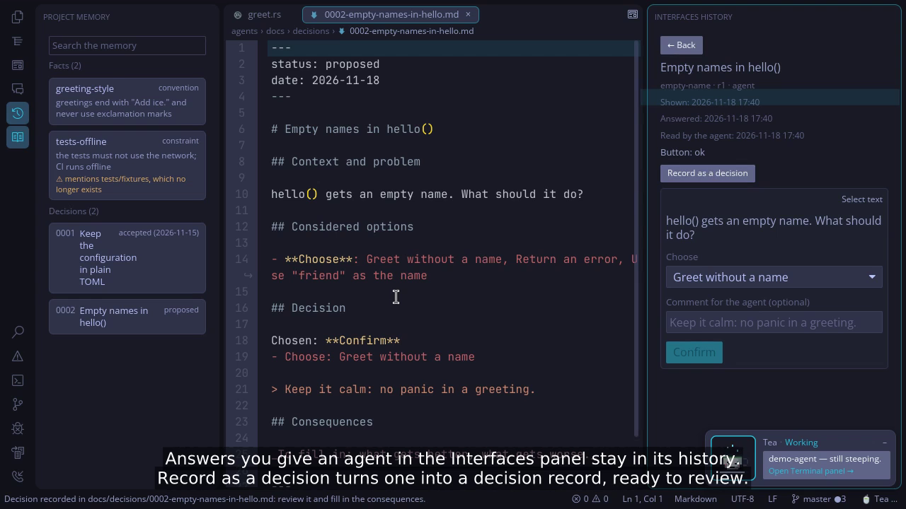

<p align="center">
  
</p>

<h1 align="center">IDE TEA</h1>

<p align="center"><b>只管写代码。冰，你自己加。</b></p>

<p align="center">
  一个用纯Rust写成的、快而安静的IDE。编程智能体先问，再动手。<br>
  一直免费：<a href="LICENSE">Apache 2.0</a>。没有账号，没有遥测，没有扩展市场。
</p>

<p align="center">
  <a href="https://github.com/fabiocmazzo/idetea/actions/workflows/ci.yml"></a>
  <a href="https://github.com/fabiocmazzo/idetea/releases"></a>
  <a href="LICENSE"></a>
  <a href="https://www.rust-lang.org/"></a>
  <a href="https://github.com/iced-rs/iced"></a>
  
  <a href="https://codeberg.org/fabiocmazzo/idetea"></a>
</p>

<p align="center">
  <a href="README.md">English</a> · <a href="README.pt-BR.md">Português</a> · <a href="README.es.md">Español</a> ·
  <a href="README.fr.md">Français</a> · <a href="README.de.md">Deutsch</a> · <a href="README.it.md">Italiano</a> ·
  <a href="README.ja.md">日本語</a> · <a href="README.zh-CN.md"><b>中文（简体）</b></a><br>
  <a href="https://idetea.belabs.cloud/zh-cn/"><b>网站和指南</b></a>
  · <a href="https://github.com/fabiocmazzo/idetea">GitHub</a>
  · <a href="https://codeberg.org/fabiocmazzo/idetea">Codeberg</a> (镜像)
</p>

<p align="center">
  <a href="https://idetea.belabs.cloud/zh-cn/#demo">
    
  </a>
</p>

<p align="center">
  <a href="https://idetea.belabs.cloud/zh-cn/#demo"><b>观看52秒演示</b></a>
  · 英语旁白，字幕嵌在画面里<br>
  GitHub不会在README里播放仓库中的视频文件。
  上面的动图会在网站上打开它，可以带声音播放。
  文件本身是<a href="assets/idetea-demo.mp4"><code>assets/idetea-demo.mp4</code></a>。
</p>

---

> **状态：**正在积极开发，尚未到1.0。已在Linux、macOS（Apple Silicon）和Windows（x86_64）上构建并测试。
> 边角还会糙，发现问题请反馈。

## 适合谁

适合在编辑器旁边用终端里的智能体写代码的人：Claude Code、Codex，或任何会读`AGENTS.md`和`CLAUDE.md`的智能体。IDE TEA不在窗口里塞一个聊天模型。它给那个智能体一条很小的、基于文件的路，用来问你问题，并且让每一条命令都由你做主。

## 留下来的理由

**快。**启动远低于200ms。50MB的文件在零点一秒内打开。一行长到离谱的压缩文件会以轻量模式打开，而不是把窗口卡死。

**安静。**没有账号，没有遥测，没有扩展市场，没有你没要的弹窗。只有你要求时才用网络（推送、拉取、获取，或你安装的一项技能）。外观、快捷键和面板都在一个普通的TOML文件里。

**跑什么，你来批。**智能体写一份小的JSON文件，IDE就显示一张表单：选项、复选框、文本、图像、声音、分步的手工测试。终端请求会先把整条命令摊开。助手可以在自己的git工作树里跑。项目永远不能给自己授权。允许列表在*你的*配置里。

**该有的地方是齐的。**多光标、临时缩放、可选的vim模式、文件树、项目搜索、集成终端、git（暂存、差异、提交、推送和拉取）、LSP、用gdb调试，以及Markdown、SVG、图像和PDF的预览。

**内核很小。**内核只编辑文件。文件树、终端、git和调试器都是你可以关掉的扩展。Tea是一只像素茶杯，有问题在等时它会留意（点一下就打开对应的面板），你想把角落要回来时，它会收进状态栏。

一条命令就能教会这个项目里的智能体：“界面: 教会本项目的智能体”会把协议写进`AGENTS.md`和`CLAUDE.md`。

## 功能实况

五段短片，英语旁白，字幕嵌在画面里。GitHub不会在README里播放仓库中的视频文件。点击海报会在网站上打开片段，可以带声音播放。文件在`assets/`里。

<table>
<tr>
  <td width="50%" valign="top">
    <a href="https://idetea.belabs.cloud/zh-cn/#feature-agents"></a><br>
    <a href="https://idetea.belabs.cloud/zh-cn/#feature-agents"><b>智能体</b></a> · 57秒<br>
    智能体在终端里。记忆在仓库里。<br>
    <a href="assets/idetea-agents.mp4"><code>assets/idetea-agents.mp4</code></a>
  </td>
  <td width="50%" valign="top">
    <a href="https://idetea.belabs.cloud/zh-cn/#feature-tables"></a><br>
    <a href="https://idetea.belabs.cloud/zh-cn/#feature-tables"><b>表格</b></a> · 45秒<br>
    数据就是表格。内容仍是纯文本。<br>
    <a href="assets/idetea-tables.mp4"><code>assets/idetea-tables.mp4</code></a>
  </td>
</tr>
<tr>
  <td width="50%" valign="top">
    <a href="https://idetea.belabs.cloud/zh-cn/#feature-lsp"></a><br>
    <a href="https://idetea.belabs.cloud/zh-cn/#feature-lsp"><b>LSP</b></a> · 41秒<br>
    深入的语言支持，内置于编辑器。<br>
    <a href="assets/idetea-lsp.mp4"><code>assets/idetea-lsp.mp4</code></a>
  </td>
  <td width="50%" valign="top">
    <a href="https://idetea.belabs.cloud/zh-cn/#feature-encodings"></a><br>
    <a href="https://idetea.belabs.cloud/zh-cn/#feature-encodings"><b>编码</b></a> · 47秒<br>
    旧文件，新编辑器，什么都不会丢。<br>
    <a href="assets/idetea-encodings.mp4"><code>assets/idetea-encodings.mp4</code></a>
  </td>
</tr>
<tr>
  <td width="50%" valign="top">
    <a href="https://idetea.belabs.cloud/zh-cn/#feature-mascot"></a><br>
    <a href="https://idetea.belabs.cloud/zh-cn/#feature-mascot"><b>吉祥物</b></a> · 52秒<br>
    一杯平静的茶，用你的语言。<br>
    <a href="assets/idetea-mascot.mp4"><code>assets/idetea-mascot.mp4</code></a>
  </td>
  <td width="50%" valign="top"></td>
</tr>
</table>

## 安装

**Linux、macOS和Windows，下载就能跑。**当前版本是
[v0.20.0](https://github.com/fabiocmazzo/idetea/releases/tag/v0.20.0)。
该页的`SHA256SUMS`里是校验和。有更新版本时请改`VERSION`，或到[Releases](https://github.com/fabiocmazzo/idetea/releases)里选文件。

**Linux (x86_64).** 解压并运行`install.sh`。它会把`idetea`放到`~/.local/bin`，并加入应用菜单：

```sh
VERSION=0.20.0
curl -fsSL -O "https://github.com/fabiocmazzo/idetea/releases/download/v${VERSION}/idetea-${VERSION}-x86_64-linux.tar.gz"
tar -xzf idetea-${VERSION}-x86_64-linux.tar.gz
cd idetea-${VERSION}-x86_64-linux
./install.sh
```

ARM请改用`idetea-${VERSION}-aarch64-linux.tar.gz`。如果更想要单个文件，下载`IDE_TEA-${VERSION}-x86_64.AppImage`（或`IDE_TEA-${VERSION}-aarch64.AppImage`），先`chmod +x`再运行。`--install-desktop`会把它加进菜单。

**macOS (Apple Silicon).** 压缩包里有`IDE TEA.app`：

```sh
VERSION=0.20.0
curl -fsSL -O "https://github.com/fabiocmazzo/idetea/releases/download/v${VERSION}/idetea-${VERSION}-aarch64-macos.tar.gz"
tar -xzf idetea-${VERSION}-aarch64-macos.tar.gz
cd idetea-${VERSION}-aarch64-macos
./idetea --install-desktop   # 创建 ~/Applications/IDE TEA.app
```

目前还没有Intel Mac的包。

**Windows (x86_64).** 下载并运行
[IDE_TEA-0.20.0-x86_64-setup.exe](https://github.com/fabiocmazzo/idetea/releases/download/v0.20.0/IDE_TEA-0.20.0-x86_64-setup.exe)，
或解压便携版
[idetea-0.20.0-x86_64-windows.zip](https://github.com/fabiocmazzo/idetea/releases/download/v0.20.0/idetea-0.20.0-x86_64-windows.zip)
（里面是`idetea.exe`）。在PowerShell中：

```powershell
$Version = "0.20.0"
Invoke-WebRequest -Uri "https://github.com/fabiocmazzo/idetea/releases/download/v$Version/IDE_TEA-$Version-x86_64-setup.exe" -OutFile "IDE_TEA-$Version-x86_64-setup.exe"
Start-Process ".\IDE_TEA-$Version-x86_64-setup.exe"
```

**从源码安装。**需要[Rust](https://rustup.rs)（stable）。包名是`tea-app`，二进制名是`idetea`：

```sh
cargo install --locked --git https://github.com/fabiocmazzo/idetea tea-app
idetea --install-desktop   # 可选：应用菜单项和图标
```

可选：git集成需要`git`，调试需要`gdb` 14+（macOS上可用`lldb-dap`），以及你要用的语言服务器（rust-analyzer、clangd、pyright、typescript-language-server、gopls、lua-language-server、zls、`zx lsp`、Hare的`hare-lsp`和MoonBit的`moon lsp`已经配好）。

## 代码签名与隐私

Windows安装程序还没有代码签名，首次运行时SmartScreen可能会发出警告。除非用户明确要求，本程序不会向其他联网系统传输任何信息。见[`CODE_SIGNING_POLICY.md`](CODE_SIGNING_POLICY.md)。

## 快速开始

```sh
idetea                # 把当前文件夹当作项目打开
idetea src/main.rs    # 当前文件夹，并打开这个文件
idetea ~/project      # 另一个文件夹
idetea new my-app --model rust --agent claude     # 新建项目，智能体可以马上开工
```

在IDE里：`Ctrl+Shift+P`打开命令面板，`Ctrl+P`按名称打开文件，`F1`列出全部快捷键。指南在[网站](https://idetea.belabs.cloud/zh-cn/)上。

## 什么时候选IDE TEA，什么时候不选

[`docs/comparativo-ides.zh-CN.md`](docs/comparativo-ides.zh-CN.md)是和VS Code、Cursor、Zed、JetBrains、Helix的一份诚实对比，已按0.15.0更新。要点：

- 终端里的智能体得到一套原生的、基于文件的协议（表单、经你批准的命令、工作树、Tea吉祥物）。那篇笔记里的其他编辑器没有这个。
- 故意没有幽灵文本补全。如果你要按Tab补全，或要行内差异，那份文档会指向Cursor、Windsurf或Zed。
- 代码操作、内联提示和调试器的覆盖面，落后于VS Code和JetBrains。

### Tea

角落里的茶杯，每种心情有好几句台词。它会注意到一次保存、一段长时间的停顿、一天里的时辰，以及调试器的构建，偶尔也会提起一条真实的快捷键。`[mascot] chatty`可以是`quiet`、`normal`或`chatty`；`[mascot] tips`打开或关掉这些提示。整个界面，包括Tea，有葡萄牙语、英语、西班牙语、法语、德语、意大利语、日语和简体中文（`[ui] language`，或跟随系统语言）。未保存的修改和磁盘上的变化顶上、git 冲突、任务或调试结束、编码写不下的字符，以及一次全部替换，它各说一句。警告和错误清零只在 chatty 里出现。同样的开关在设置画面里。`idetea mascot setup-hooks` 会加上 Claude Code 的钩子，文件里已有的钩子留着。它不抢焦点。

## 给仓库点星

如果这就是你想要的编辑器，[给IDE TEA点星](https://github.com/fabiocmazzo/idetea)。这是一个人的项目，星星是下一个人找到它的办法。

## 关于这个名字

一开始是个玩笑。这个IDE用**iced**写成，所以当然得叫**Iced Tea**。

然后另一个意思出现了。在葡萄牙语里，**TEA**是*Transtorno do Espectro Autista*：自闭症谱系障碍。作者是自闭症开发者，这个双关刚好，就留下来了。也许它也解释了这个IDE的几件事：它喜欢可预测，喜欢你读得懂的纯文本，喜欢尽可能少的噪声。

更多内容见[宣言](MANIFESTO.zh-CN.md)。

## 文档

- [宣言](MANIFESTO.zh-CN.md)：IDE TEA相信什么，以及它不会做什么。
- [网站](https://idetea.belabs.cloud/zh-cn/)：演示、安装和指南。
- [Contributing](CONTRIBUTING.md)：如何构建、测试并提交pull request（英文）。
- [功能与快捷键](docs/features.zh-CN.md)：完整清单。
- [语言](docs/languages.zh-CN.md)：IDE为每种语言做了什么，包括Hare和MoonBit，并附有可试的[示例](examples/languages)。
- [给智能体的界面](docs/interfaces/formato.md)和[智能体终端](docs/terminais-de-agente.md)（暂时为葡萄牙语）。
- [SPEC.md](SPEC.md)和[DESENVOLVIMENTO.md](DESENVOLVIMENTO.md)：规格、架构，以及如何构建、测试和写扩展（暂时为葡萄牙语）。

## 许可证

IDE TEA是[Apache License 2.0](LICENSE)下的自由软件：可以用、可以研究、可以修改、可以分享，包括商业用途。它不收费，也会一直这样。

界面图标来自[Codicons](https://github.com/microsoft/vscode-codicons) © Microsoft，许可为[CC BY 4.0](https://creativecommons.org/licenses/by/4.0/)（见[`crates/tea-core/assets/NOTICE.md`](crates/tea-core/assets/NOTICE.md)）。
