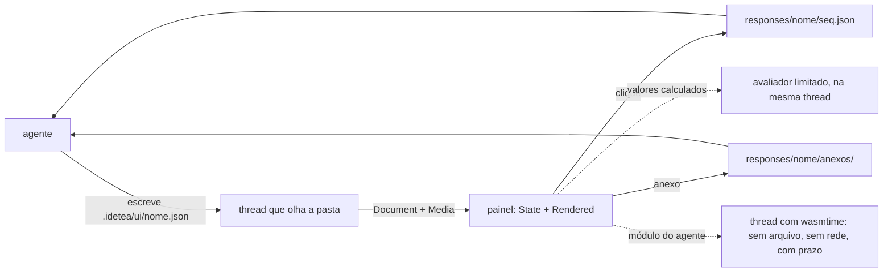

# 02 — Arquitetura proposta

Marcadores: **[Fato]** conferido no código ou em documentação; **[Hipótese]** provável, não testado;
**[Recomendação]** proposta, a decidir na [RFC 0026](../rfc/0026-interfaces-para-revisar-e-simular.md).

## O princípio

O mecanismo atual funciona e é usado: 241 documentos em três projetos, com resposta, histórico e confirmação. A
evolução **acrescenta** ao formato `idetea-ui` 1, sem trocar o transporte nem o modelo de estado. Cada etapa é um
componente ou um campo novo, com o leitor velho ignorando o que não conhece (já acontece: `Kind::Unknown` e os
avisos de campo desconhecido).

As linhas cheias existem ou são pequenas; as pontilhadas são as etapas com decisão em aberto.

## O transporte continua sendo arquivo

**[Recomendação]** Manter os arquivos como base e não acrescentar IPC.

- **A favor:** funciona com qualquer agente que escreve arquivo (Claude Code, Codex, um script); sobrevive a uma IDE
  que reinicia (a resposta fica no disco); o histórico e o `idetea ask` já estão em cima dele; o `stat` a cada
  250 ms custa pouco. **[Fato]** A latência que o usuário sente é a do agente, não a do `stat`.
- **Contra o IPC:** um socket pede descoberta da IDE certa (a RFC 0024 já teve esse problema com duas IDEs abertas,
  resolvido por `IDETEA_ROOT`), some quando a IDE fecha e não fica no histórico.
- **Onde um evento faria falta:** um valor calculado pelo **agente** a cada mudança de campo (cenário E). Isso
  fica com o avaliador ou o módulo dentro da IDE, sem ida e volta.

## Quem é dono de cada valor

Hoje há dois donos, o agente (`data`) e o usuário (`State.local`). **[Recomendação]** Um terceiro, só de leitura:

| Dono | Onde | Na resposta |
| --- | --- | --- |
| Agente | `data` do documento | só se estiver no `context` |
| Usuário | `State.local` | o que o `context` pedir |
| Calculado | `State.computed` (novo), refeito a cada mudança | em `computed`, separado de `values`, para o agente nunca confundir uma conta da IDE com uma escolha do usuário |

## As capacidades, em níveis

Cada nível pede mais confiança e mais isolamento. Um documento usa o nível mais baixo que resolve.

| Nível | O que é | Isolamento | Confirmação |
| --- | --- | --- | --- |
| 0 | JSON declarativo (hoje) | limites de tamanho, ponteiros, sem caminho fora da raiz | nenhuma |
| 1 | Arquivos de mídia do projeto (hoje) | cabeçalho conferido antes de decodificar, thread fora da interface | nenhuma |
| 2 | Valores calculados por expressões | linguagem sem laço, limite de nós e de profundidade, sem acesso a nada fora do `data` | nenhuma |
| 3 | Módulo WASM do agente | wasmtime com combustível e prazo, memória limitada, sem WASI de arquivo nem rede, numa thread | uma vez por hash do módulo, como um terminal pedido |
| 4 | Comando ou processo | o pedido de terminal que já existe (RFC 0005) | sempre, vendo o comando |

**[Fato]** O nível 4 já existe e cobre "rodar uma ferramenta". O nível 3 é o único com risco novo dentro do
processo da IDE.

## Por que não um interpretador de scripts

| Opção | Custo de começar | Por execução | Risco para a IDE | Veredito |
| --- | --- | --- | --- | --- |
| Expressões sem laço (CEL ou avaliador próprio) | microssegundos | microssegundos | nenhum: termina sempre | **nível 2** |
| Script restrito (Rhai, Lua) | baixo | baixo | laço infinito e memória exigem limites de operação; outra linguagem para o agente aprender | rejeitado: o meio-termo que ninguém pediu |
| WASM com wasmtime | compilar o módulo: dezenas de ms **[Hipótese]**, com cache | microssegundos a ms | baixo com combustível, prazo e `StoreLimits` | **nível 3**, reusando `tea-plugins` |
| Processo auxiliar | dezenas de ms por início | IPC por chamada | nenhum para a IDE | já existe como nível 4 |
| Código nativo confiável | — | — | derruba a IDE se falhar | rejeitado: confiar no modelo não é confiar no código |

## O que é declarativo e o que é do runtime

- **Declarativo (o agente escreve):** componentes, valores iniciais, expressões de conta (`"=memoria * usuarios"`),
  condições de mostrar (`show_if`), o que vai na resposta.
- **Runtime (a IDE faz):** ler mídia com limites, tocar, animar, comparar, zoom, avaliar expressões, rodar módulos
  com prazo, gravar anexos, contar o que foi visto.
- **Nunca no JSON:** laço, função definida pelo agente, acesso a arquivo por expressão, rede.

## Alternativas rejeitadas

- **HTML ou um webview.** Puxa um navegador para dentro da IDE, foge do iced e de tudo o que o painel já mede
  (visto, tocado, aberto). `idetea:open/index.html` já cobre o caso "o agente fez uma página".
- **Um registro dinâmico de componentes.** São 13 componentes; o enum fechado dá exaustividade e testes simples.
- **Trocar o formato por uma versão 2.** Nada do que está proposto quebra a versão 1.
